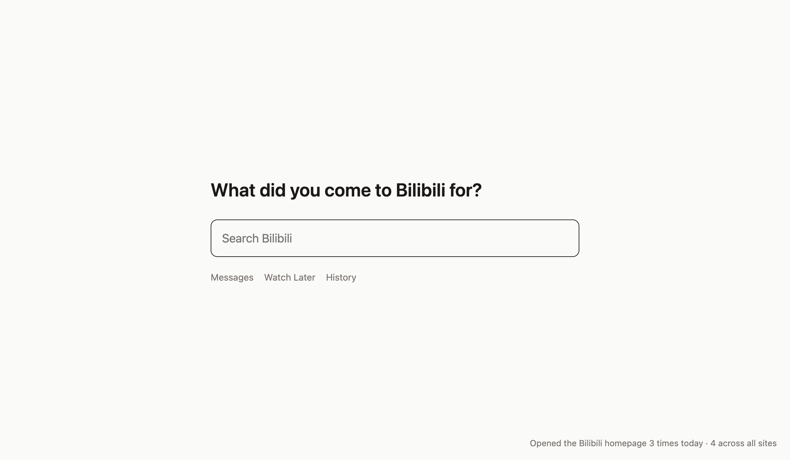
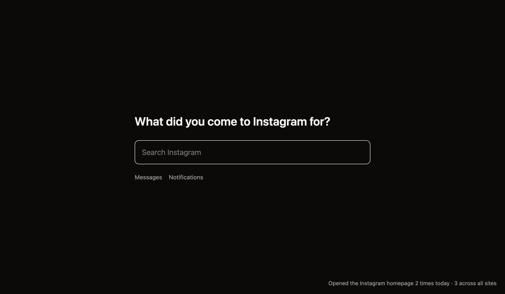

# Feed Gate

A Chrome extension that puts an intent gate in front of the home feeds of X (Twitter), Bilibili, Zhihu, Xiaohongshu (RedNote) and Instagram.

Open one of those homepages and you don't get an algorithmic feed. You get one question: *"What did you come here for?"* Type what you came for and you land straight on the site's search results. Quick links take you to notifications, messages and other non-feed pages. There is no "just browse" button.

| Light | Dark |
|---|---|
|  |  |

The corner counter shows how many times you reached for each feed today.

## Why

The distraction usually starts with a habit: you type `x.com` or `bilibili.com` without thinking, and the feed takes over. Feed Gate only targets that entry point. Search results, video pages, notes and profiles are untouched. If you came with a purpose, the gate costs nothing, because you were going to type that query anyway. If you came without one, you get nowhere.

## Install (Chrome / Arc / Edge / Brave)

1. Open `chrome://extensions` and turn on **Developer mode**.
2. Click **Load unpacked** and select this repo's `extension/` directory.
3. Open the extension's **Details** and turn on **Allow in Incognito**. An extension can't turn this on itself. Without it, opening an incognito window bypasses the gate.
4. After changing the code, click the reload button on the extension card.

## What gets gated

| Site | Gated homepages |
|---|---|
| X | `x.com/`, `x.com/home` |
| Bilibili | `www.bilibili.com/` |
| Zhihu | `www.zhihu.com/` |
| Xiaohongshu | `www.xiaohongshu.com/`, `/explore` |
| Instagram | `www.instagram.com/` |

Only homepages are gated. Trending pages, Instagram's Explore and Reels tabs, and sidebar recommendations on video pages are out of scope; see the design doc.

To add a site, make all of these changes:
- add an entry to `extension/sites.js`;
- add its hosts to `host_permissions` in `manifest.json`;
- add homepage and non-homepage cases to `test/sites.test.js`, including the explicit site id list;
- update the `description` in `manifest.json`, which names the sites.

## How it works

A homepage can be reached in three ways, so interception has three layers. All of them come from one config file, `extension/sites.js`.

| How you reach the homepage | What catches it |
|---|---|
| Full page load: typed URL, link, reload | `declarativeNetRequest` redirect rules, before the request is sent |
| In-site SPA navigation, such as clicking the logo (`pushState`, no request) | `webNavigation.onHistoryStateUpdated` |
| Navigations DNR can't see: answered by the site's own service worker, or restored from bfcache | `webNavigation.onCommitted` |

The last two layers swap in the gate with `location.replace`, which replaces the homepage's history entry. Because of that, pressing Back once returns you to where you were, instead of trapping you on the gate.

## Known behavior

- Clicking the logo inside a site may show the feed for a split second before the gate replaces it. SPA navigations send no request, so they can only be caught after the fact.
- Sites whose web app runs its own service worker (X does) may flash the feed briefly even when you type the URL, for the same reason. It always ends on the gate.
- After being gated, pressing Back once takes you to the page you were on before.
- Reloading the gate, or returning to it with Back or Forward, doesn't increase the counter. Only a real gated visit does.

## Development

```bash
pnpm install
pnpm exec playwright install chromium   # once per machine, before the first test:e2e run
pnpm test        # unit tests (node --test)
pnpm test:e2e    # end-to-end tests: loads the real extension, runs fully offline, no login needed
pnpm check       # syntax check
```

Design doc (Chinese): [`docs/superpowers/specs/2026-10-11-feed-gate-design.md`](docs/superpowers/specs/2026-10-11-feed-gate-design.md)
